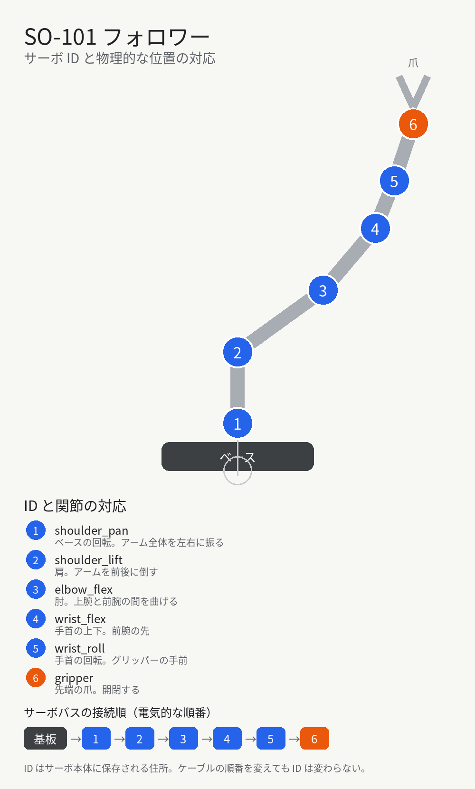

# SO-101 セットアップ

SO-101 のリーダーアームとフォロワーアームを、この PC で動かすための作業ディレクトリです。

## この実機の構成

- リーダーアーム 1台
- フォロワーアーム 1台
- Pro キット（リーダー 5V、フォロワー 12V）

12V の AC アダプタはフォロワー専用です。
リーダーに接続するとサーボが壊れるため、アダプタには「5V」「12V」のラベルを貼って区別します。

### 動作確認済みの構成

| 機器 | ポート | 備考 |
|---|---|---|
| フォロワー | `/dev/so101-follower` | 12V、キャリブレーション済み |
| リーダー | `/dev/so101-leader` | 5V、キャリブレーション済み |
| カメラ | `/dev/video4` | InnoMaker U20CAM-1080p-S1 |

テレオペレーションは `./scripts/teleop.sh` で動作確認済みです。
カメラは USB ポートの都合で現在は外しています。
カメラも同時に使う場合は、給電付き USB ハブを挟みます。

## 配線の全体像

SO-101 はアーム1台につき3系統のケーブルしか使いません。
系統を分けて考えれば、ケーブルの山はすぐに整理できます。

| 系統 | 本数（2アーム合計） | 接続 |
|---|---|---|
| USB | 2 | PC から制御基板へ（USB-C） |
| 電源 | 2 | AC アダプタから制御基板へ（DC ジャック） |
| サーボバス | 2 | 制御基板からサーボ6個へ（3ピン、数珠つなぎ） |

PC から出る USB は2本、AC アダプタも2個です。
それ以外のケーブルはサーボバスなので、アームの外には出ません。
この3系統を色やラベルで分ければ、配線は迷いません。

## サーボの並び順

各アームの6個のサーボには決まった順番があり、ID 1〜6 が割り当てられます。

| ID | ジョイント | 役割 |
|---|---|---|
| 1 | shoulder_pan | ベースの回転 |
| 2 | shoulder_lift | 肩の上下 |
| 3 | elbow_flex | 肘の曲げ伸ばし |
| 4 | wrist_flex | 手首の上下 |
| 5 | wrist_roll | 手首の回転 |
| 6 | gripper | グリッパーの開閉 |

サーボバスは「制御基板 → ID 1 → ID 2 → … → ID 6」の一列につなぎます。
途中で分岐させたり、最後のサーボから基板へ戻したりしません。



ID はサーボ本体に保存された住所であり、ケーブルの接続順とは別です。
電気的にはどの順でつないでも通信できますが、ケーブルの取り回しに合わせて ID 順に沿わせます。

## セットアップの順番

実機を目の前にして作業する場合は、[実機セットアップ手順書](docs/quickstart.md) を上から順に進めてください。
各作業の背景と確認方法は、次の資料にあります。

1. [配線を整理する](docs/hardware.md)
2. [ソフトウェア環境を確認する](docs/software.md)
3. udev ルールを入れる
4. ポートを特定する
5. モーターの ID とボーレートを設定する
6. リーダーとフォロワーをキャリブレーションする
7. テレオペレーションで動作確認する

## 初期設定が終わった後のクイックスタート

```bash
./scripts/teleop.sh
```

スクリプトは内部で `uv run` を使います。
Python を直接実行する場合も `uv run python ...` としてください。

`scripts/teleop.sh` は `/dev/so101-leader` と `/dev/so101-follower` を使います。
この2つのシンボリックリンクは、ポート固定の手順で作成します。

## ディレクトリ構成

```
SO101/
├── README.md             このファイル
├── docs/
│   ├── quickstart.md     実機作業のチェックリスト
│   ├── hardware.md       ケーブルの見分け方と配線手順
│   └── software.md       環境構築、ID 設定、キャリブレーション
├── scripts/
│   ├── check_servos.py   サーボの ID、電圧、温度を一括確認
│   ├── check_mapping.py  ID と関節の対応を確認
│   ├── agent_control_check.py  小さな動作で 自律制御とカメラを確認
│   ├── capture_pose.py   絶対角度で姿勢を指定して撮影、顔検出
│   ├── scan_for_face.py  姿勢を組み合わせて顔が写る向きを探す
│   ├── track_face.py     カメラで顔をリアルタイム追跡
│   ├── install_udev.sh   USB シリアルの権限を設定
│   ├── pin_ports.sh      アームごとに固定のポート名を割り当て
│   ├── status.sh         接続状態をまとめて表示
│   └── teleop.sh         テレオペレーションを起動
└── .venv/                Python 3.12 と LeRobot
```

## 困ったとき

| 症状 | 確認する場所 |
|---|---|
| `/dev/ttyACM0` が出ない | USB ケーブルがデータ通信対応か、基板のジャンパが B 側か |
| `Permission denied` | `scripts/install_udev.sh` を実行したか |
| サーボが見つからない | デイジーチェーンの向き、電源、ID 設定の順番 |
| リーダーが重い | リーダーとフォロワーのサーボを入れ替えていないか |
| キャリブレーションが失敗する | 可動域の途中で止まっていないか、電源が切れていないか |

まず `./scripts/status.sh` を実行すると、ポート、固定名、udev ルール、権限をまとめて確認できます。
詳しい切り分けは [docs/software.md](docs/software.md) のトラブルシューティングにあります。
