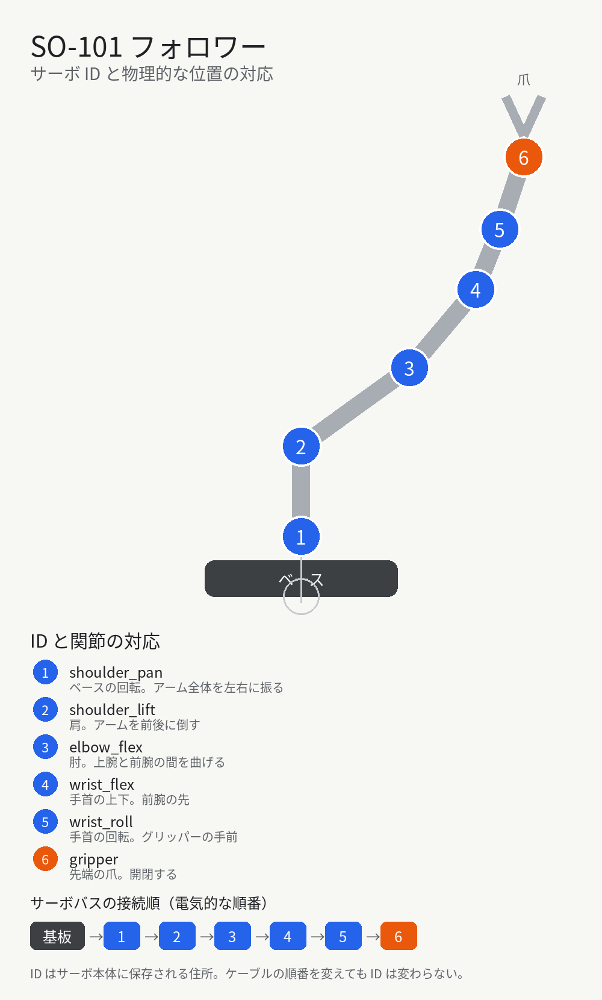

# ハードウェアの配線

ケーブルの山をほどく前に、SO-101 が使うケーブルは3種類しかないことを確認します。
種類ごとに分けてから、アームごとの配線に進みます。

## 最初に確認する電源の電圧

SO-101 のキットには **Standard** と **Pro** があり、フォロワーのサーボ電圧が異なります。
間違った電圧を加えるとサーボが壊れるため、配線より先にアダプタのラベルを読みます。

| キット | リーダー | フォロワー |
|---|---|---|
| Standard | 5V | 5V |
| Pro | 5V | 12V |

リーダーはキットの種類にかかわらず 5V です。
フォロワーが Pro の場合は 12V のアダプタを使います。
12V のアダプタをリーダーに接続するとサーボが壊れるため、アダプタには必ず電圧を書いたラベルを貼ります。

AC アダプタの本体に印刷された出力電圧を確認し、5V と 12V のアダプタにはマスキングテープで「5V」「12V」と書いて貼ります。
どちらがどちらか判別できない場合は、サーボ本体のラベルで電圧を確認してから接続します。
確認できるまでは電源を入れません。

## ケーブルを3種類に分ける

机の上に出して、次の3種類に分けます。

| 種類 | 見た目 | 本数（2アーム合計） |
|---|---|---|
| USB | USB-C のケーブル | 2 |
| 電源 | AC アダプタと丸い DC ジャック | 2 |
| サーボバス | 細い3ピンのケーブル | 12以上 |

USB ケーブルは充電専用では通信できません。
PC と基板をつないだときに `/dev/ttyACM0` が見えない場合は、データ通信対応のケーブルに交換します。

## 制御基板のコネクタ

Waveshare の **Bus Servo Adapter** が各アームに1枚付きます。
基板には次のコネクタとスイッチがあります。

- USB-C: PC と接続する
- DC ジャック: AC アダプタを接続する
- 3ピンのサーボポート: サーボバスを接続する
- ジャンパピン: 2個
- 電源スイッチ: 基板によっては付いている

### ジャンパを B 側にする

基板のジャンパ2個は、どちらも **B チャンネル（USB）** に差します。
A チャンネルは UART 用で、PC から USB 経由でサーボを制御するときは使いません。
ジャンパが A 側のままだと、USB を接続してもサーボと通信できません。

### 基板の向き

基板はアームのベースに固定します。
USB と DC ジャックが後ろを向くようにすると、ケーブルがアームの可動部に絡みません。

## アームの見分け方

リーダーとフォロワーは見た目が似ていますが、先端で区別できます。

- **フォロワー**: 先端に把持用の爪（グリッパー）が付いている
- **リーダー**: 先端に手で握るハンドルとトリガーが付いている

サーボも混ぜないようにします。
フォロワーは6個とも 1/345 のギア比です。
リーダーはジョイントごとにギア比が異なり、1/191、1/345、1/147 が混在します。

サーボを入れ替えると、リーダーが重くて動かせなくなったり、フォロワーのトルクが不足したりします。
解体した状態から組み立てる場合は、サーボ本体の型番とギア比を確認してから取り付けます。

## サーボバスのつなぎ方

STS3215 のサーボには3ピンのポートが2つあります。
この2つは内部で並列につながっているため、どちらを入力にしても出力にしてもかまいません。

サーボバスは次の一列につなぎます。

```
制御基板 → サーボ1 → サーボ2 → サーボ3 → サーボ4 → サーボ5 → サーボ6
```

途中で分岐させたり、サーボ6から基板へ戻したりしません。
分岐やループがあると、バス上で信号が衝突してサーボを認識できなくなります。

### ID とジョイントの対応

| ID | ジョイント | 位置 |
|---|---|---|
| 1 | shoulder_pan | ベースの回転 |
| 2 | shoulder_lift | 肩の上下 |
| 3 | elbow_flex | 肘の曲げ伸ばし |
| 4 | wrist_flex | 手首の上下 |
| 5 | wrist_roll | 手首の回転 |
| 6 | gripper | グリッパーの開閉 |

最初の ID 設定では、サーボを1個ずつ基板に直結します。
新品のサーボはすべて ID 1 で出荷されるため、数珠つなぎのままでは区別できません。



ID はサーボ本体に保存された住所です。
ケーブルの接続順を変えても ID は変わりません。
どの ID のサーボがどの関節に付いているかが、物理的な位置の対応になります。

電気的には ID 順でなくても通信できます。
ケーブルの長さと取り回しに合わせて、ID 順に沿わせるのが実用的です。

## ケーブルにラベルを貼る

サーボバスのケーブルはどれも同じに見えるため、ラベルがないと接続順を間違えます。
マスキングテープとペンで、次のルールで貼ります。

- サーボ本体に `F1` から `F6`、`L1` から `L6`
- ケーブルの両端にも同じ番号
- 基板には `F` と `L` のどちらのアームか

`F` はフォロワー、`L` はリーダーです。
番号はサーボの ID と一致させます。

ケーブルの長さで区別しようとすると、組み替えたときに破綻します。
番号で管理します。

## ケーブルをアームに沿わせる

配線はアームのリンクに沿わせ、関節で遊びを持たせます。

- 関節の可動域の端まで動かして、ケーブルが引っ張られないことを確認する
- ケーブルはマジックテープでリンクに固定する。結束バンドは締めすぎない
- USB と電源ケーブルはベースの後ろに逃がし、アームの可動部に巻き込まない
- グリッパー付近のケーブルは、爪の開閉を妨げない位置に固定する

関節を動かすたびにケーブルが突っ張る場合は、固定位置を1つ手前のリンクに移します。

## 電源を入れる順番

配線が終わったら、次の順番で電源を入れます。

1. サーボバスのコネクタがすべて奥まで差さっていることを確認する
2. AC アダプタを基板の DC ジャックに接続する
3. 基板のスイッチを入れる
4. USB ケーブルを PC に接続する

電源を切るときは逆の順番で行います。
サーボバスのケーブルを抜き差しするときは、必ず電源を切ります。

## 配線チェックリスト

電源を入れる前に、次を確認します。

- [ ] USB ケーブルが2本あり、どちらもデータ通信対応である
- [ ] AC アダプタの電圧がアームに合っている（Standard は 5V、Pro のフォロワーは 12V）
- [ ] 基板のジャンパ2個が B 側になっている
- [ ] サーボバスが基板から ID 1、2、3、4、5、6 の順につながっている
- [ ] サーボバスに分岐やループがない
- [ ] サーボ本体とケーブルのラベルが一致している
- [ ] 関節を可動域の端まで動かしてもケーブルが突っ張らない
- [ ] リーダーとフォロワーのサーボを混ぜていない

すべて確認できたら、[ソフトウェアのセットアップ](software.md) に進みます。
